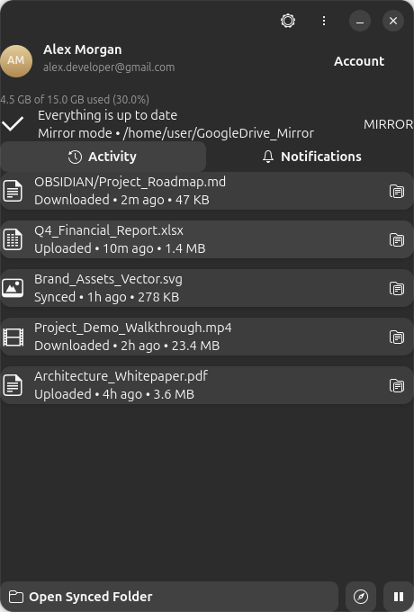
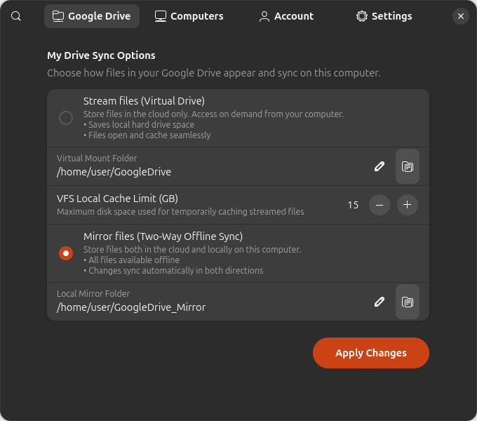
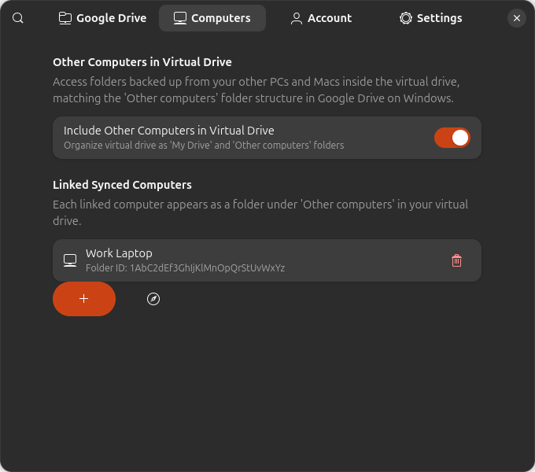
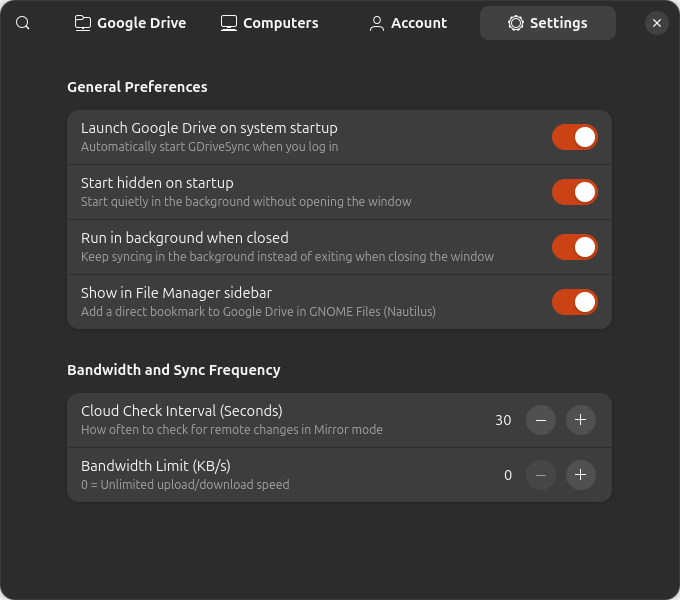
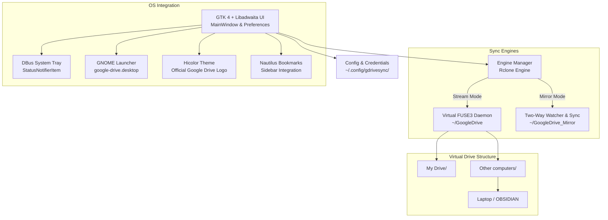

# Google Drive Desktop for Linux (GDriveSync)

<div align="center">


### The Official Google Drive Experience, Natively Engineered for Linux.

[](https://ubuntu.com)
[](https://gnome.org)
[](https://rclone.org)
[](https://python.org)
[](LICENSE)

**Stream files on-demand, mirror folders offline, sync other computers into a unified virtual drive, and launch directly from GNOME Activities with the official Google Drive icon.**

[🚀 Features](#-key-features) • [📸 Screenshots](#-screenshots) • [⚡ Installation](#-installation) • [📂 Architecture](#-system-architecture) • [🌐 Website](#-project-website)

---



</div>

---

## 🌟 Key Features

### 1. Two Full Sync Modes (Identical to Windows & macOS Clients)
* ☁️ **Stream Files (Virtual FUSE Drive)**:
  * Files remain in the cloud and stream on-demand into `~/GoogleDrive`.
  * Opens files seamlessly with zero wait time and **consumes virtually no local disk space**.
  * Intelligent VFS caching with configurable cache limits (e.g., 10 GB).
  * Edits made locally upload automatically in real-time.
* 💾 **Mirror Files (Two-Way Offline Sync)**:
  * Synchronizes your cloud files to local storage (`~/GoogleDrive_Mirror`).
  * **100% offline access** to all files anytime, anywhere.
  * Real-time file system watchers trigger instant bi-directional synchronization.

### 2. "Other Computers" in the Same Virtual Drive
* Directly matches the official Windows client layout (`G:\Other computers\`):
  ```
  ~/GoogleDrive/
  ├── My Drive/
  │   ├── Documents/
  │   └── Projects/
  └── Other computers/
      ├── Laptop/
      │   └── OBSIDIAN/
      └── Office Workstation/
          └── CAD Models/
  ```
* Link any remote computer's backed-up folder using its Google Drive folder link or folder ID.
* Works seamlessly across both **Stream** and **Mirror** modes.

### 3. Native Linux & GNOME Shell Integration
* 🔍 **System Search Integration**:
  * Registered as `Google Drive` in Ubuntu / GNOME Activities.
  * Press <kbd>Super</kbd> and search `drive`, `google drive`, or `gdrive` to launch.
  * Features the **official, multi-resolution Google Drive icon** across all standard sizes (`16px` to `512px`).
* 🎛️ **Background Execution & System Tray**:
  * Runs quietly in the background upon window close (`X`).
  * Top panel AppIndicator / StatusNotifierItem for instant access.
  * Autostart on boot with `--hidden` flag for zero-interruption startup.
* 📁 **Nautilus (GNOME Files) Sidebar Bookmark**:
  * One-click access to your Google Drive directly from the file manager sidebar.

---

## 📸 Screenshots

| Main Status & Activity | Stream vs. Mirror Sync Modes |
| :---: | :---: |
|  |  |
| *Real-time sync status, storage quota meter, and live file activity feed.* | *Choose between virtual on-demand streaming or offline two-way mirror sync.* |

| "Other Computers" Virtual Drive | System & Autostart Settings |
| :---: | :---: |
|  |  |
| *Manage folders backed up from other laptops and workstations.* | *Background execution, silent autostart on boot, and bandwidth limits.* |

---

## ⚡ Installation

### Prerequisites
Tested on **Ubuntu 22.04 LTS / 24.04 LTS / 26.04**, Debian, and modern GNOME Linux distributions with Python 3.10+ and standard GTK 4 / Libadwaita libraries.

```bash
# Ubuntu / Debian dependencies
sudo apt update
sudo apt install -y python3-gi python3-gi-cairo gir1.2-gtk-4.0 gir1.2-adw-1 fuse3 curl unzip
```

### ⚡ One-Command Install (Curl)
Open your terminal and paste:
```bash
curl -fsSL https://raw.githubusercontent.com/Tanay2920003/Google-Drive-for-ubuntu/main/install.sh | bash
```

### Or Install via Git
```bash
git clone https://github.com/Tanay2920003/Google-Drive-for-ubuntu.git
cd Google-Drive-for-ubuntu
chmod +x install.sh run.sh
./install.sh
```

The installer will automatically:
1. Verify and configure the high-performance cloud engine.
2. Download the official Google Drive vector logo from the internet and generate anti-aliased square PNGs for all system resolutions (`16x16` to `512x512`).
3. Install `google-drive.desktop` into `~/.local/share/applications/` and configure background autostart.
4. Add the `google-drive` CLI command to `~/.local/bin/`.
5. Refresh the GNOME icon cache and desktop search index.

---

## 🚀 Usage

### Launching the Application
* **From Applications Search**:
  Press <kbd>Super</kbd> (Windows key), type `Google Drive` or `drive`, and hit <kbd>Enter</kbd>.
* **From Terminal (GUI Window)**:
  ```bash
  ./run.sh
  ```
* **From Terminal (Silent Background Mode)**:
  ```bash
  ./run.sh --hidden
  ```
* **From Command Launcher**:
  ```bash
  gtk-launch google-drive
  ```

### Connecting Your Account
1. Open the application.
2. Click **Account -> Sign In with Google** (or select built-in **Offline Demo Mode** for testing).
3. Authorize Google Drive in your web browser.
4. Your account profile, storage quota, and files will connect instantly.

---

## 📂 System Architecture



### Repository Structure
```
GDRIVSYNC/
├── assets/
│   ├── gdrive_icon.svg             # Official vector SVG logo
│   ├── gdrive_icon.png             # High-res 512x512 logo
│   ├── icons/                      # Multi-resolution icons (16px - 1024px)
│   └── screenshots/                # Application screenshots
├── bin/
│   └── rclone                      # High-performance static cloud engine binary
├── docs/                           # Official GitHub Pages Showcase Website
│   ├── index.html                  # Landing page
│   ├── styles.css                  # Custom Vanilla CSS design system
│   ├── script.js                   # Interactive website interactions
│   └── assets/                     # Web assets and screenshots
├── gdrive_sync/
│   ├── config.py                   # Central settings & state manager
│   ├── main.py                     # GTK 4 + Libadwaita entry point
│   ├── engine/
│   │   ├── oauth.py                # OAuth2 flow & local redirect listener
│   │   ├── rclone_manager.py       # Config builder & process controller
│   │   ├── stream_service.py       # Virtual FUSE3 streaming daemon
│   │   └── mirror_service.py       # Two-way folder sync daemon
│   ├── ui/
│   │   ├── main_window.py          # Status, storage meter & activity feed
│   │   ├── preferences_dialog.py   # Stream vs Mirror & Computers manager
│   │   ├── oauth_dialog.py         # Account sign-in dialog
│   │   ├── tray_indicator.py       # Top panel StatusNotifierItem
│   │   └── style.css               # Libadwaita dark mode theme styling
│   └── utils/
│       ├── bookmarks.py            # Nautilus sidebar bookmark manager
│       ├── desktop_entry.py        # Desktop launcher & autostart generator
│       └── download_logo.py        # Internet logo downloader & icon installer
├── install.sh                      # One-click system installer
├── run.sh                          # App launcher script
└── README.md                       # Documentation
```

---

## 🌐 Project Website

The project includes an interactive website ready to be hosted on **GitHub Pages**:
- Located in the [`docs/`](docs/) directory.
- Simply navigate to your GitHub repository **Settings -> Pages -> Source: Deploy from a branch -> Branch: main -> Folder: /docs**.
- Features interactive sync mode comparisons, a live virtual drive explorer, full screenshot carousels, and one-click install snippets.

---

## 📄 License

This project is licensed under the MIT License - see the [LICENSE](LICENSE) file for details.
